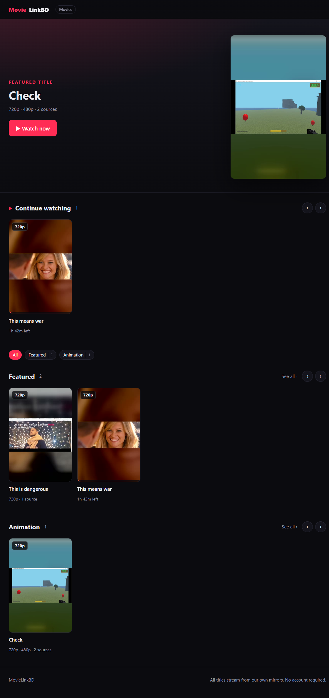
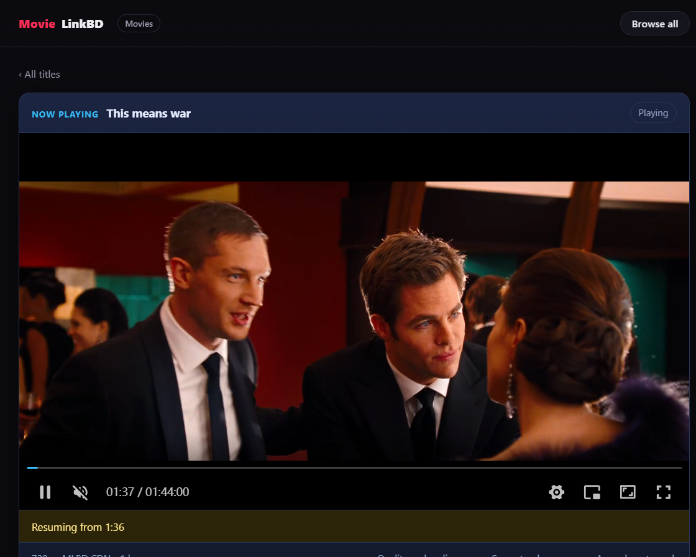

# Online Video Player

A movie library you host yourself. Browse rows of films, open one, and watch —
then add more from the browser through an admin page that probes each upload,
converts the formats browsers cannot play, and keeps a smaller copy for slow
connections.

**Live:** <https://movies.hafizr283.me>



## What it does

| | |
|---|---|
| **Browse** | Category rows, a "Continue watching" shelf, a page per category, and progress bars on the cards you have started. |
| **Watch** | Remembers the position, hold to play at 2×, keyboard shortcuts, fullscreen/PiP, and a quality menu that steps down to 480p by itself after repeated stalls. |
| **Add** | Drag a file into `/admin`. The server identifies it (container, codec, audio), takes a poster frame from the film, and tells you plainly when a browser will not play it. |
| **Convert** | HEVC, Matroska, AC-3 and friends are re-encoded to H.264/AAC — or remuxed untouched when only the container is the problem. A 480p rendition is made beside every conversion. |
| **Publish** | Optionally send a film to Azure Blob storage and let viewers stream it from Microsoft's edge instead of your uplink. |
| **Depend on nothing** | Zero npm dependencies. Node's standard library for the server, the encoder, and the Blob client. |



## Quick start

Requires Node 22 or newer (developed on Node 24).

```bash
node server.mjs
# open http://127.0.0.1:8890
```

That starts with three short demo clips so the pages have something to show.
The real library is whatever you add under `/admin`.

**Admin.** Set a token before starting, then open `/admin` and paste it:

```powershell
$env:ADMIN_TOKEN = "a-long-random-string"
node server.mjs
```

With no `ADMIN_TOKEN`, every admin route answers **404** — the page is not even
advertised. The token travels in the `X-Admin-Token` header, never in a URL.

**Conversion** needs `ffmpeg` on `PATH` (or `FFMPEG_PATH` pointing at
`ffmpeg.exe`). Without it, uploading, browsing and playback all still work; the
admin just reports that it cannot repair an unplayable file.

## Where the files go

```
<storage>/                 videos, library.json, posters, the admin token
  library.json             the catalogue: plain JSON, edited by the admin
  posters/                 poster frames taken from each film
public/                    the web root only
```

Media is deliberately **outside** the web root. A file dropped in `public/`
would be downloadable directly, bypassing the short-lived playback token; the
static route also refuses `.mp4` by extension, so the mistake cannot reopen the
hole. `/p/<slug>` streams a file only after the gate mints a token for it, and
the response supports byte ranges so seeking works.

Deleting a title deletes **catalogue entries, never files**. The bytes stay and
the admin lists them as unused — the honest state: nothing claims them, and
nothing destroyed them.

## Configuration

Every option is optional; the defaults run a local demo.

| Variable | Default | Meaning |
|---|---|---|
| `ADMIN_TOKEN` | unset | enables `/admin`; unset means every admin route is 404 |
| `PORT` | `8890` | site port |
| `HOST` | `127.0.0.1` | bind address |
| `STORAGE_DIR` | `./storage` | media, manifest, posters, token |
| `FFMPEG_PATH` | `ffmpeg` | encoder used for conversion and poster frames |
| `TRANSCODE_ENCODER` | `libx264` | or a hardware encoder: `h264_amf`, `h264_nvenc`, `h264_qsv` |
| `TRANSCODE_RENDITIONS` | `480` | height of the small copy, or `none` |
| `AZURE_CONTAINER_URL` | unset | `https://<account>.blob.core.windows.net/<container>` |
| `AZURE_SAS` | unset | a **container** SAS with Read/Add/Create/Write |

Publishing to Blob storage, the gate, and the mirrors are described in
[HOSTING.md](HOSTING.md).

## How a play works

```
browser ──GET /movie/<id>──▶ server        page + obfuscated player config
        ◀──────────────────
browser ──GET /g───────────▶ server        short-lived ?mg= token for that source
        ──GET /p/<slug>?mg=▶ server        H.264/AAC with Range support
        (or ──────────────▶ Azure Blob)    when the film was published
```

The mirrors exist so a broken CDN can be simulated and the player's failover is
tested rather than assumed: three origins serve the same media, one is wired to
fail every request.

## Tests

```bash
node selftest.mjs      # server contract: catalogue, gate, ranges, admin, conversion plans
node test-azure.mjs    # the Blob publish path against a mock container
node cdp-demo.mjs      # a real browser over CDP: playback, quality switch, admin flow
```

`selftest.mjs` needs the server started with `DEV_PANEL=1` and the same
`ADMIN_TOKEN`; `test-azure.mjs` needs no Azure account and no network.

## Notes

- The Blob SAS is a credential. It is read from `<storage>/.azure.env`, is never
  printed, and never reaches a browser — the container is public-read instead.
- Uploads are capped at 2 GiB by default (`MAX_UPLOAD_BYTES`).
- This is a personal project, not a service. It ships no media.

What is next, and why it is not done yet: [docs/ROADMAP.md](docs/ROADMAP.md).
